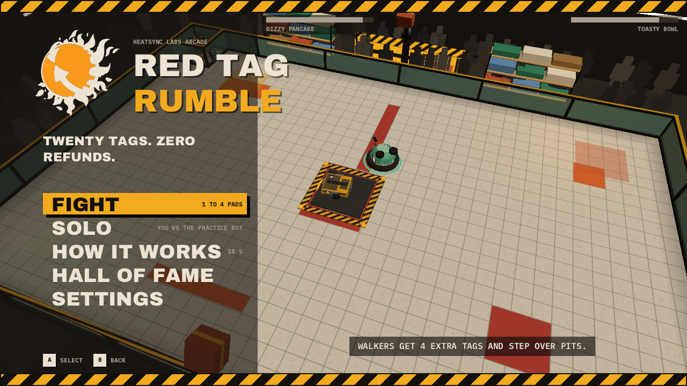
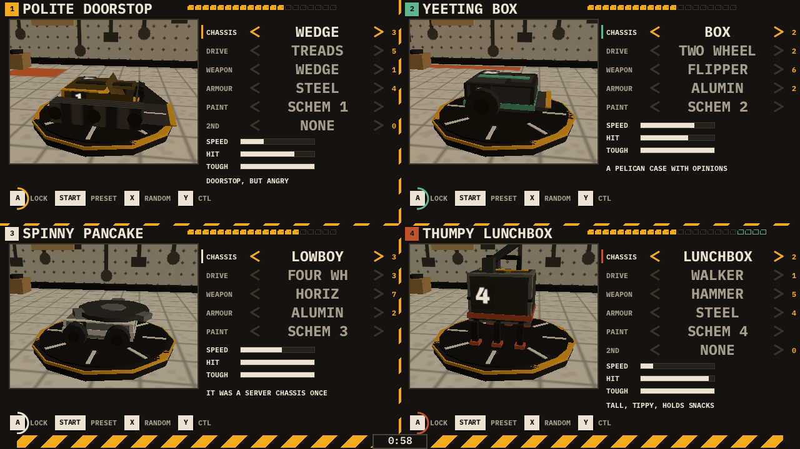
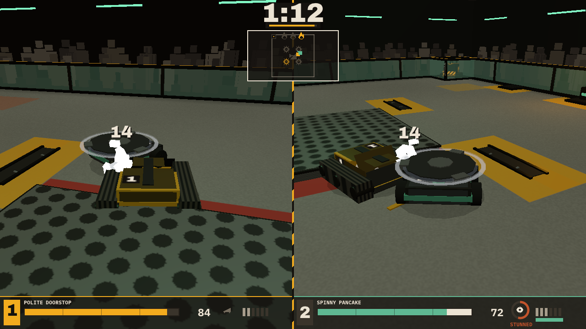
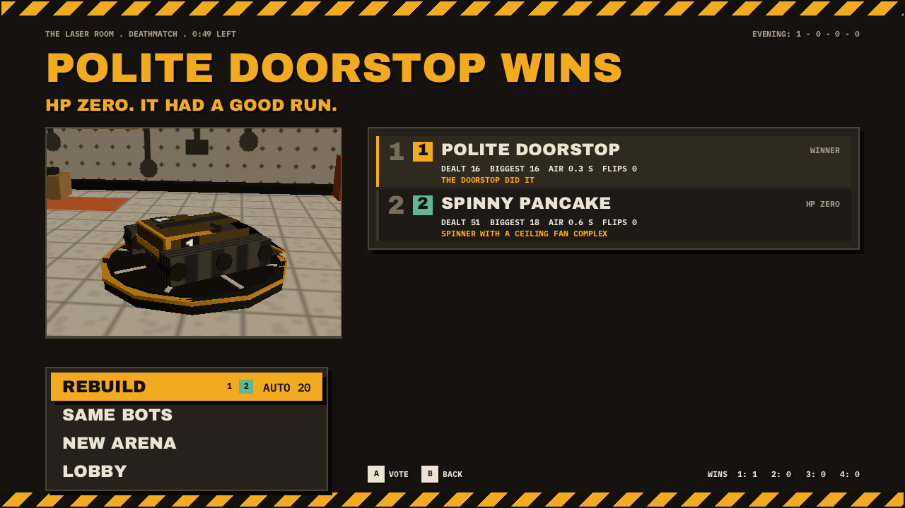

# RED TAG RUMBLE

A split-screen robot combat cart for wasmcart, built at HeatSync Labs for the shop's game station. One to four gamepads. Sixty seconds in the garage spending twenty red tags on a chassis, a drive, a weapon and armour, then a fight in one of six hackerspace arenas with hazards on a timer, a house robot that clears the aisle when the fight stalls, and a KO that goes slow motion.

A red tag on a project means fourteen days and then it is free for the taking or it is trash. Everything on the garage shelf is red tagged. Build a bot from other people's abandoned projects, drive it into another bot made of other people's abandoned projects, and whatever survives goes back on the shelf.



## An evening

1. Title. FIGHT for 1 to 4 pads, SOLO against the practice bot (EASY on a fresh cabinet; hold Y in the garage with Left or Right for MEDIUM or HARD), HOW IT WORKS (seven rules cards, about 18 s), HALL OF FAME and SETTINGS. Leave it alone and two house AIs fight in THE BAY behind the menu.
2. Lobby. Any pad joins with A, B, X, Y or Start. Pick a mode, X flips your stick scheme between ARCADE and TANK, A marks READY, and Start readies you and goes to the garage. Y plays HOW IT WORKS. FILL WITH BOT puts AI seats in the empty chairs, each with a different bot. On a cabinet's first evening HOW IT WORKS plays itself once before the lobby; any button skips it.
3. Garage. One panel per seat around a turntable with your bot on it. Spend the tags, lock in with A, or press Start to lock and go.
4. Arena vote. Six cards; the stick picks, A votes, majority wins, ties go random. The vote closes 2 s after everyone has voted, or at 8 s.
5. Countdown, then the fight. Each seat gets its own camera: halves for two, quadrants for four, two plus a big map for three, one full view for solo. One approach is one hit and no single hit takes more than a fifth of a bot, so a fight runs about 35 to 60 s; the music is a 156 bpm industrial track that brings in a rising riff for the last 20 s or when a bot is under 30 HP.
6. KO or TIME. A KO goes slow motion on a shared camera; TIME goes to the judges (damage, aggression, control).
7. Results and the rematch vote: REBUILD, SAME BOTS, NEW ARENA or LOBBY. The evening tally and the hall of fame persist in the cabinet's save. A table that says nothing after a fight goes back to the lobby after 40 s, and an empty lobby back to the title, so an abandoned cabinet returns to the attract on its own.



## The garage

Twenty tags. Five rows: CHASSIS, DRIVE, WEAPON, ARMOUR, PAINT, plus a 2ND WEAPON row when the build has a mount for one (a WEDGE or LIFTER weapon, or the LUNCHBOX chassis). Up and Down pick a row, Left and Right cycle the part; illegal parts are skipped and say why. The PAINT row walks the four schemes and the four decal sets. The three bars, SPEED, HIT and TOUGH, are the whole stat system: the tables stay hidden.

- A locks the bot on the press. B releases it.
- Start locks the bot too, and starts: once every human is locked the AI seats lock as they stand and the tape snaps to the arena vote.
- A tap of Y cycles the presets: ROLL OUT, LAUNCH, CHOP, STOMP, TOAST, SPIN and RANDOM. Holding Y for 0.4 s shows the controls card over your panel instead. Holding Y with Up, Down, Left and Right steps the table's shared settings: the 3 player match card (FIGHT LENGTH, ONE CAMERA, COMEBACK) and the practice bot's EASY, MEDIUM, HARD. An unseated pad steps them with its stick alone.
- X rolls a RANDOM BOT on a slot machine.
- RT (or R, the W key) test-fires the weapon on the turntable. The right stick scrubs the turntable (optional; a pad without one loses nothing).
- WALKER legs add 4 tags to the budget and LEG TRACKS add 2. Over budget, the bar shakes, A and Start play the deny sound and a line at the bottom says why.
- On a rebuild the panel shows one hint from your last fight.

The shared 60 s timer is the caution tape along the bottom (30 s on a rebuild). At zero every bot not yet locked locks exactly as it stands; only a build that cannot lock (over budget or a weapon with no mount) is trimmed to the nearest legal build, cheapest optional parts first, and a line at the bottom says so for 2 s.

## Controls

W3C standard gamepad. The keyboard is pad 1: arrows, Z (A), X (B), A (X), S (Y), Enter (Start), right Shift (Select), Q and W (L and R). The d-pad drives the same axes as the left stick everywhere, so a keyboard needs no stick and no trigger.

| Input | Fight |
|---|---|
| Left stick or d-pad | drive: throttle and steer (HOVER and MELTY: the direction to travel, relative to your camera) |
| Right stick | camera nudge, 30 degrees, springs back; turntable scrub in the garage |
| A or RT | weapon: hold for spinners, flame and lifter, tap for flipper, hammer, spike and crusher, tap toggles the saw |
| B | brake; self-right when upside down; hold 1 s to leave the lobby or garage |
| X | taunt; RANDOM BOT in the garage |
| Y | hold for the controls card, in the garage and the fight; a tap in the garage cycles the presets; a tap in the lobby plays HOW IT WORKS; held with the d-pad or stick it steps the garage's shared settings |
| L or LT | boost (not on TREADS or LEG TRACKS) |
| Start | pause in the fight; ready and go in the lobby; lock and go in the garage; confirm on the vote and rematch menus; skips the rules flash and the judges card; backs out of settings. Enter always does something. |

TANK scheme puts the left side on the left stick and the right side on the right stick (the d-pad still drives both sides). Knocked out in a free-for-all? You get a hazard seat: the stick picks a hazard and A fires it.



## Modes

| Mode | Rule |
|---|---|
| DEATHMATCH | 1 to 4. HP zero, last one up. |
| KO BY FLIP | no HP; flip them or drop them. |
| LAST BOT STANDING | 3 or 4. The knocked out get the hazards. |
| KING OF THE HILL | hold the square alone; 30 points or the best score at the bell. |
| 2V2 | four seats, two teams, friendly fire at half. |
| TOURNAMENT | 3 or 4 players in a bracket of 1v1 fights; in the final, the eliminated crew drive OPS. |

COMEBACK (on in free-for-all and 2V2, off in any 1v1) adds the RED TAG boost under 30 HP and repair panel pickups.

## Arenas

| Arena | Hook |
|---|---|
| THE BAY | an open pit and two pulverizer hammers |
| THE LASER ROOM | kill saws, flame grates and a laser sweep to duck |
| THE FREE PILE | a mound in the middle and screw conveyors |
| THE DOCK | a loading deck, rain and a gap to fall through |
| THE SHOP | benches that break when you drive through them |
| THE ROOF | no rails on two edges, and wind |

OPS, the house robot, wakes when a fight goes quiet or a pin lasts too long, picks up whoever is hogging it, and carries them toward the middle.



## Build it

Needs emsdk at `~/emsdk`, node 22 or newer, and the submodules (`git submodule update --init`).

```sh
./build.sh                 # build/red-tag-rumble.wasc, also copied to web/
./build.sh balance         # the native balance tool, build/balance
./build.sh music           # rebake the music stems in assets/music
./build.sh lint            # the house lint over the strings and docs
```

## The rig

`tools/shot.mjs` runs the cart headless on the same GL path the station uses, with scripted pads, and writes PNGs of chosen frames. The sim is deterministic under the rig's seed, so a frame always shows the same picture.

```sh
node tools/shot.mjs build/red-tag-rumble.wasc build/shots/s 120,260,900 tools/scripts/2p-fight.json
STATION=1 node tools/shot.mjs ...     # only pad 1 reports connected, as the RetroArch core does
WAV=build/out.wav node tools/shot.mjs ...                      # also write the audio
SAVE_OUT=build/s.sav node tools/shot.mjs ...                   # write the save region at the end
SAVE_IN=build/s.sav node tools/shot.mjs ...                    # boot with that save
build/balance --robin 20                                       # every preset pair on every arena, the AI driving
node tools/serve.mjs 8794 & node tools/play.mjs 'http://127.0.0.1:8794/?v=1' build/play   # a real Chrome, keyboard only
```

`HANDOFF.md` lists every script, tool and check.

## Deploy

- Browser: `npm run serve` and open the page. The Pages workflow publishes `web/` to https://virgilvox.github.io/red-tag-rumble/ on every push to main. Source: https://github.com/virgilvox/red-tag-rumble
- Game station: copy `web/red-tag-rumble.wasc` to `/userdata/roms/wasmcart/` on the Batocera box and restart EmulationStation.

## Stack

three.c (three.js r186 in C99) for the 3D, a CPU painted 1280 x 720 HUD composited in a second render pass (only the bands that changed go to the GPU each frame), Bellows for the live sound effects, three songs composed in Bellows and baked to six WAV stems (a 100 bpm garage groove, the 156 bpm arena track with a stomp verse and a breakbeat chorus, a 172 bpm overtime siren), and a deterministic 60 Hz simulation that compiles natively for balancing. The same `.wasc` runs in the browser, in RetroArch and on the station.

MIT licensed. Fonts under the SIL Open Font License (assets/fonts/OFL.txt).
